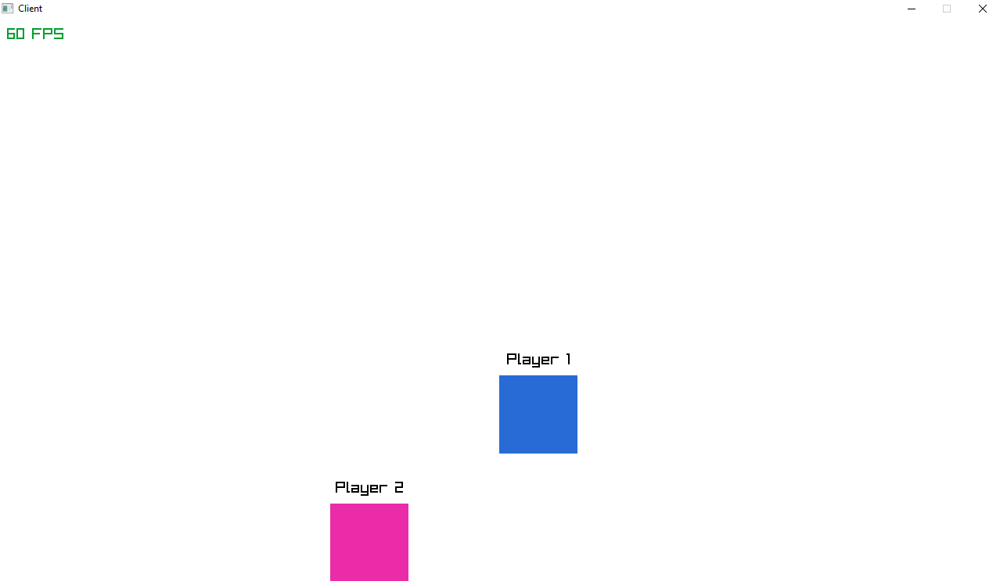

## INFO

This is my attempt of making a multiplayer game server mainly
using C, winsock and Raylib (https://github.com/raysan5/raylib).

Details: 
  - User can launch server on their machine
  - User can join a server
  - Simple server & client prediction logic
  - No lag prevention or handling

NOTED: For the server to be able to reach users that are
not from your local network you need to use a port fowarder
or a proxy server (UDP). (In this project I use [playit.gg](https://playit.gg/))

## ~DEMO

- Testing with my friend:
  
  

## Conclusion

The project was a massive success, It only take me about 5 days
to make the whole thing. Although the server was not the greatest,
it was still a fun experience.